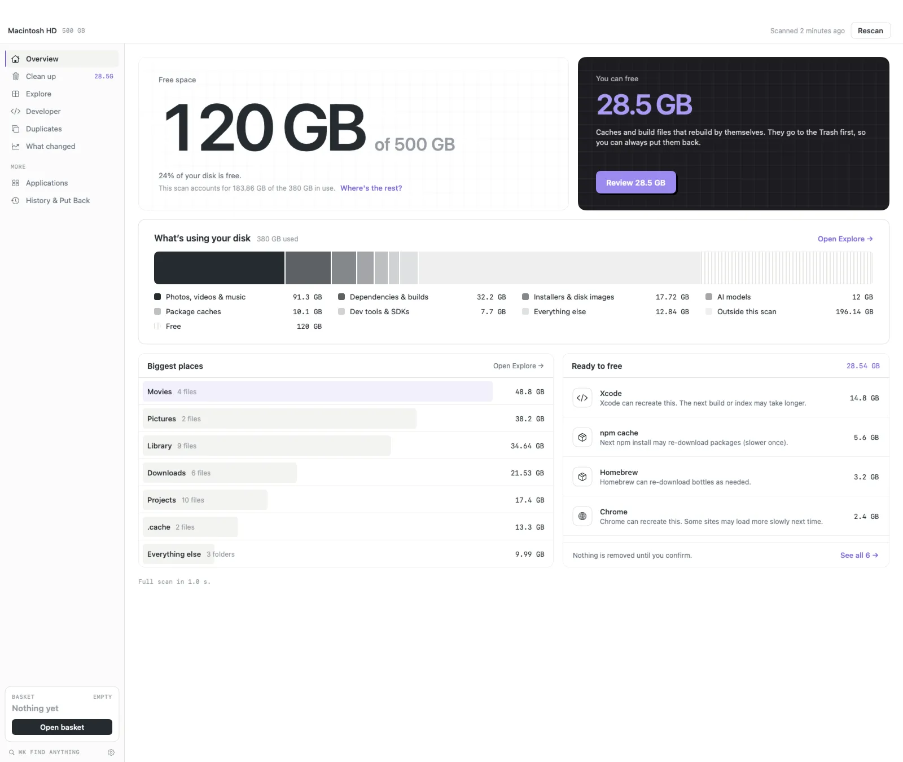
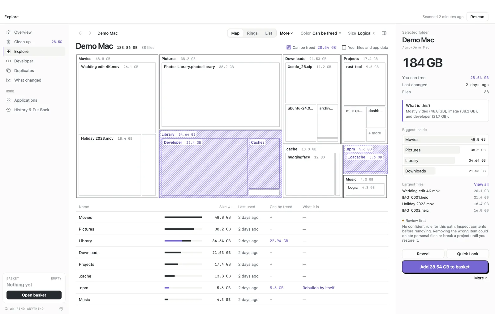
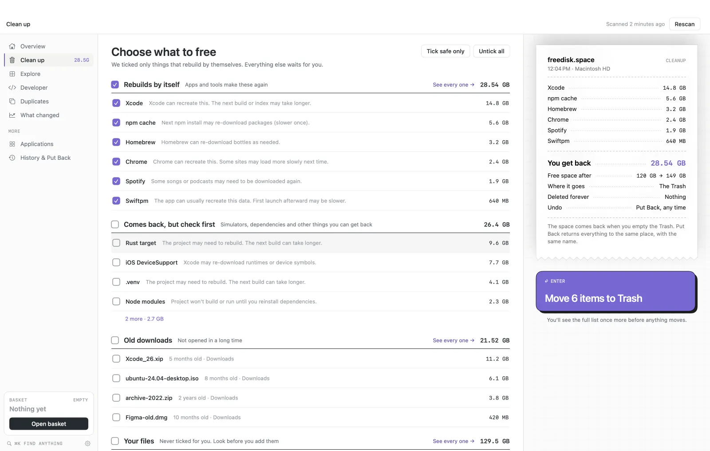
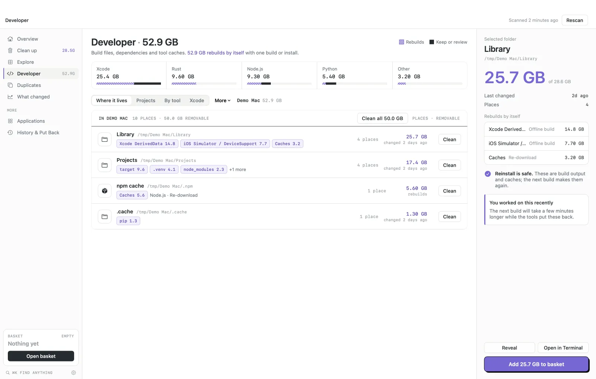
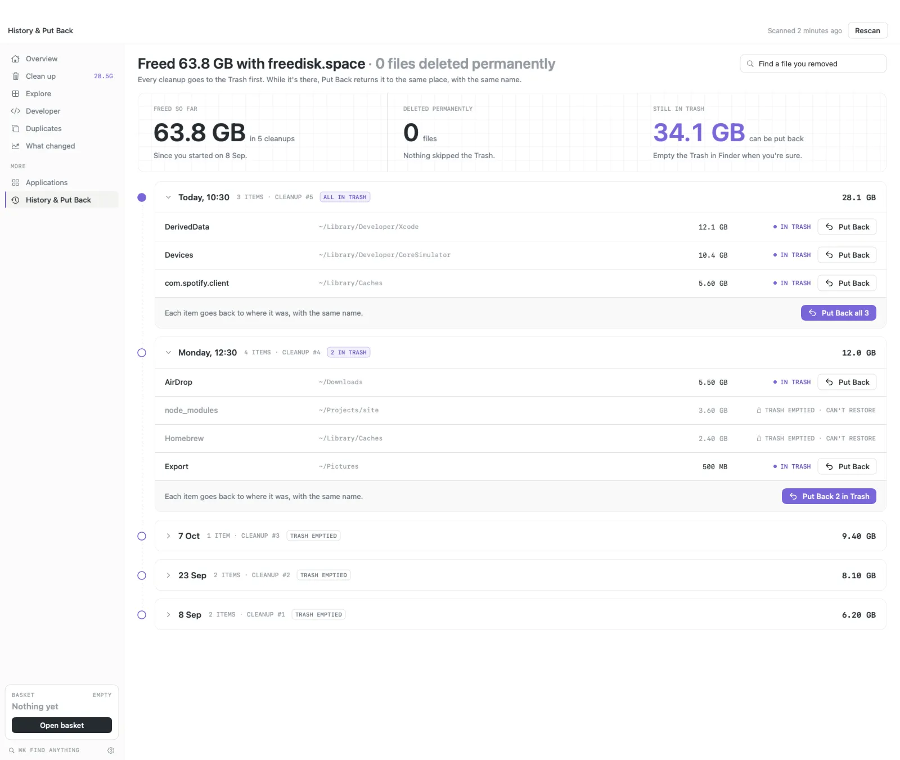

<div align="center">


# freedisk.space

**Space makes sense here.**

A free, open source disk space analyzer for Mac and Windows.<br>
See what's filling your disk, learn what each thing is, and free space without the fear of losing something.

[](https://github.com/Ayushjo/Diskmap/releases/latest)
[](https://github.com/Ayushjo/Diskmap/releases/latest/download/freedisk.space.dmg)
[](https://github.com/Ayushjo/Diskmap/releases/download/v0.2.3/freedisk.space-0.2.3-windows-x64.exe)
[](LICENSE)
[](#privacy)

**[Download for Mac](https://github.com/Ayushjo/Diskmap/releases/latest/download/freedisk.space.dmg)** &nbsp;·&nbsp;
**[Download for Windows](https://github.com/Ayushjo/Diskmap/releases/download/v0.2.3/freedisk.space-0.2.3-windows-x64.exe)** &nbsp;·&nbsp;
[freedisk.space](https://www.freedisk.space)

</div>

<br>

<picture>
  <source media="(prefers-color-scheme: dark)" srcset="docs/readme/overview-dark.webp">
  
</picture>

<p align="center"><sub>The new design, arriving in the next update. Captured with demo files, not a real person's disk.</sub></p>

## Why freedisk.space

|  |  |  |
| --- | --- | --- |
| **Free, for real**<br>No trial, no subscription, no account. MIT licensed. | **Trash first**<br>Cleanup moves things to the Trash, never straight to deletion. Put Back returns them. | **Offline**<br>Scans never leave your computer. No analytics, no telemetry. |
| **Knows what rebuilds**<br>Caches and build files that apps make again are ticked for you. Your own files never are. | **Explains itself**<br>Every folder says what it is and what removing it would cost you. | **Built for developers**<br>Xcode, simulators, `node_modules`, Python environments, Docker and package caches, tied to the project that made them. |

## A quick tour

### Overview

How much space is free, what's using the rest by category, and what's ready to free right now. One scan, read at a glance.

### Explore

Every folder as a map, rings or a list. Striped blocks rebuild by themselves. Select anything to see what it is, how much of it can be freed, and its largest files.

<picture>
  <source media="(prefers-color-scheme: dark)" srcset="docs/readme/visualize-dark.webp">
  
</picture>

### Clean up

Only things that rebuild by themselves start ticked. A receipt shows what you get back, where it goes and how to undo it, before anything moves.

<picture>
  <source media="(prefers-color-scheme: dark)" srcset="docs/readme/cleanSafe-dark.webp">
  
</picture>

### Developer

Build output, dependencies and tool caches, grouped by tool and by the folder they live in, with what each one costs to rebuild.

<picture>
  <source media="(prefers-color-scheme: dark)" srcset="docs/readme/developerStorage-dark.webp">
  
</picture>

### History and Put Back

Every cleanup is recorded. While an item is still in the Trash, Put Back returns it to the same place with the same name.

<picture>
  <source media="(prefers-color-scheme: dark)" srcset="docs/readme/history-dark.webp">
  
</picture>

### Also inside

- **Duplicates.** Files with identical contents, compared on your computer. Cloud-only placeholders are skipped and shared APFS clones are recognised. The oldest copy in each group stays.
- **Find.** Search the whole scan with filters like `ext:mp4 size>500MB age>1y`. Press <kbd>⌘</kbd> <kbd>K</kbd> from anywhere.
- **Old downloads and forgotten files.** Installers, disk images and archives you haven't opened in months.
- **Applications.** Installed apps by size, with the support files they leave behind.
- **What changed.** Compare scans over time and see which folders grew.
- **Light and dark.** Follows your system, or pick one.

## Install

### Mac

1. Download **[freedisk.space.dmg](https://github.com/Ayushjo/Diskmap/releases/latest/download/freedisk.space.dmg)**. It runs on macOS 14 or later, on Apple silicon and Intel.
2. Drag freedisk.space to Applications.
3. The app isn't notarized yet, so macOS asks once. Open it, then go to **System Settings › Privacy & Security** and choose **Open Anyway**.

For a complete scan, grant Full Disk Access in **System Settings › Privacy & Security › Full Disk Access**. Without it, the app scans every folder it's allowed to read.

### Windows

1. Download **[freedisk.space-0.2.3-windows-x64.exe](https://github.com/Ayushjo/Diskmap/releases/download/v0.2.3/freedisk.space-0.2.3-windows-x64.exe)** for Windows 10 or 11 (x64). It's a single file, and .NET doesn't need to be installed.
2. The file isn't code signed yet, so SmartScreen may warn about an unknown publisher. Choose **More info › Run anyway**.

Checksums are listed on each [release](https://github.com/Ayushjo/Diskmap/releases).

## How cleanup stays safe

1. **Choosing isn't deleting.** Anything you pick goes to a basket first. Nothing moves until you review the list and confirm.
2. **Trash only.** Confirmed items move to the Trash (the Recycle Bin on Windows), so they can come back until you empty it. There is one exception on Windows: when the Recycle Bin refuses an item as too big, it may be deleted permanently, but only if it's a cache, dependency or build folder that rebuilds itself, and only after you confirm it in its own dialog.
3. **System folders are off limits.** A built-in list of protected locations, such as `/System`, can never be added, whatever you select.
4. **Risky things ask first.** Virtual machine disks, Docker data, apps, browser profiles and `.git` folders explain what you'd lose and suggest a safer way before you add them.

## Privacy

Scanning, cleanup, history and everything else run entirely on your computer. There are no analytics, no crash reporters and no account. The one network request the Mac app can make is an update check through Sparkle. It's off by default and only runs if you turn on **Check for updates automatically** or choose **Check for Updates…**.

## Command line

The `diskmap` command reads your disk and never deletes anything. It's handy in scripts, CI and git hooks.

```bash
swift run -c release diskmap scan ~/code --top 10                    # biggest folders and files
swift run -c release diskmap dev --reclaimable --older-than 6m       # stale dependencies and build output
swift run -c release diskmap dup ~/Pictures --min-size 1MB           # identical files
swift run -c release diskmap find ~ ext:mp4 size\>500MB age\>1y      # search with filters
swift run -c release diskmap check . --fail-over 2GB                 # exit 1 if a folder grows too big
swift run -c release diskmap export ~ --format ncdu --out scan.json  # open it later with ncdu -f
```

Add `--json` to any command for machine-readable output, or run `diskmap --help` for every option.

## Build from source

**Mac.** Needs macOS 14 or later and the Swift toolchain (Xcode or the Command Line Tools).

```bash
swift build
scripts/test.sh          # the test suite; use this rather than bare `swift test`
swift run DiskMapApp     # run the app
scripts/build-adhoc.sh   # build dist/freedisk.space.app and a disk image
```

More detail is in [SETUP.md](SETUP.md).

**Windows.** Needs the .NET 10 SDK. See [windows/README.md](windows/README.md).

```powershell
dotnet build windows\DiskMap.Win.slnx
dotnet test windows\DiskMap.Win.slnx
```

## Project layout

| Path | What's there |
| --- | --- |
| `Sources/DiskMapCore/` | Scanning, catalogs, duplicate and clone detection, layouts and the cleanup queue. No UI code. |
| `Sources/DiskMapApp/` | The native SwiftUI and AppKit app. |
| `Sources/diskmap/` | The read-only command line tool. |
| `windows/` | The native Windows app (C#, WPF). |
| `docs/` | [Product goals](docs/PRD.md), [architecture and decisions](docs/ARCHITECTURE.md), design notes. |

The project started as DiskMap. The source targets, the bundle identifier `com.ayushjo.diskmap`, the cache folders and the preference keys keep that name, so existing installs and saved scans carry over.

## Contributing

Issues and pull requests are welcome. Before you start, read [AGENTS.md](AGENTS.md). It's short, and it covers the rules every change keeps:

- All removal goes through the cleanup queue and the Trash, apart from the exceptions AGENTS.md documents.
- Nothing calls the network, apart from the optional update check.
- Changes to the protected-locations list are called out in the pull request.

Run `scripts/test.sh` before sending a change, and add a test for anything new.

## Learn more

Guides on the website explain [why System Data gets so big on a Mac](https://www.freedisk.space/guides/why-is-system-data-so-big-on-mac), [what to delete when your Mac is full](https://www.freedisk.space/guides/mac-storage-full-what-to-delete), and free alternatives to [CleanMyMac](https://www.freedisk.space/guides/cleanmymac-alternatives) and [DaisyDisk](https://www.freedisk.space/guides/daisydisk-alternatives).

## License

[MIT](LICENSE). Free to use, change and share.
