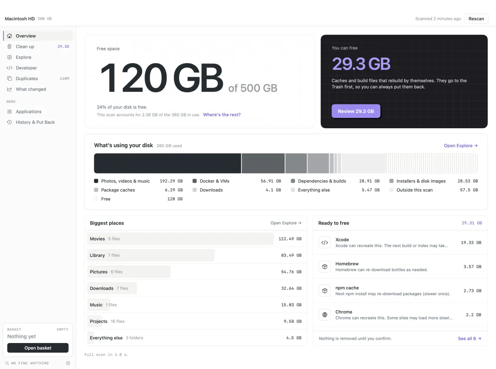
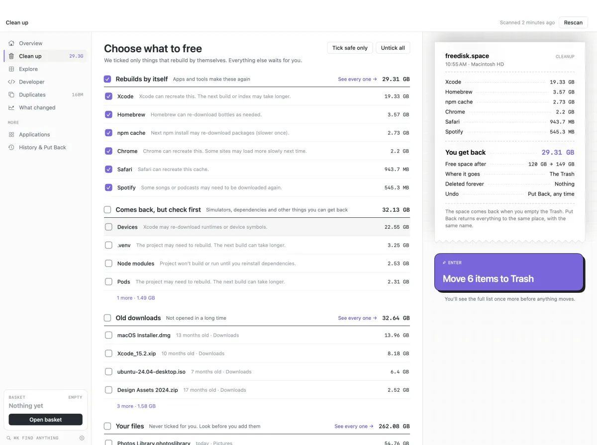

# freedisk.space

**Free, open-source disk space analyzer for Mac and Windows.** See what fills your disk as a map and by category, find out what System Data, developer files and duplicates really are, and review every cleanup before anything moves to the Trash.

[**Download for Mac**](https://github.com/Ayushjo/Diskmap/releases/latest/download/freedisk.space.dmg) · [All releases, including Windows](https://github.com/Ayushjo/Diskmap/releases) · [freedisk.space](https://www.freedisk.space)



<sub>The redesigned app shown here is coming in the next update; real render with demo files.</sub>

- **Free and MIT licensed.** No trial, no subscription, no account.
- **Mac and Windows.** macOS 14 or later on Apple silicon and Intel; Windows 10 and 11 (x64).
- **Offline.** Scans never leave your computer. The only network use is an optional update check on Mac, off by default.
- **Trash first.** Cleanup goes to the Trash (Recycle Bin on Windows), never straight to deletion, so you can put things back.
- **Honest numbers.** APFS clones are counted once, so it won't promise space that deleting wouldn't free.
- **Built for developers too.** Xcode DerivedData and simulators, Docker, node_modules, Python environments and package caches, tied to the project and tool that made them.



The Mac release is ad-hoc signed, not notarized yet: the first time you open it, approve it once in System Settings > Privacy & Security. Guides on the website explain [System Data](https://www.freedisk.space/guides/why-is-system-data-so-big-on-mac), [what to delete when your Mac is full](https://www.freedisk.space/guides/mac-storage-full-what-to-delete) and [free alternatives to CleanMyMac](https://www.freedisk.space/guides/cleanmymac-alternatives) and [DaisyDisk](https://www.freedisk.space/guides/daisydisk-alternatives).

## Mac: build and run

Requires macOS 14 or later and the Swift toolchain.

```bash
swift build
scripts/test.sh
swift run DiskMapApp
```

To make an ad-hoc signed app and disk image for local use:

```bash
scripts/build-adhoc.sh
open dist/freedisk.space.app
```

On first launch of an ad-hoc build, use **right-click → Open** if Gatekeeper warns about an unidentified developer. This is not a notarized public release. See [SETUP.md](SETUP.md) for details.

The source repository and SwiftPM executable target retain their original `DiskMap` names. The read-only CLI also remains `diskmap` so existing scripts keep working:

```bash
swift run -c release diskmap scan ~/code --top 10
swift run -c release diskmap dev --reclaimable --older-than 6m
swift run -c release diskmap find ~ ext:mp4 size\>500MB
```

## Windows

The native WPF port lives in [windows/README.md](windows/README.md). Download the installer from the [releases page](https://github.com/Ayushjo/Diskmap/releases), or build from source with .NET 10.

## How cleanup works

The app analyzes local files and stages proposed removals in a visible Cleanup queue. Only a separate final confirmation moves selected items to Trash. Cloud-only files are not opened for duplicate comparison or preview. Scans and cleanup do not send your data to a server. Optional Sparkle update checks are the only network exception, and are off by default.

## Project structure

- `Sources/DiskMapCore/`: scanning, catalogs, duplicate detection, visualization layout, and CleanupQueue.
- `Sources/DiskMapApp/`: native macOS interface and AppKit integrations.
- `Sources/diskmap/`: compatible read-only CLI.
- `windows/`: native Windows port.
- `docs/PRD.md`, `docs/ARCHITECTURE.md`, `TASKS.md`: feature targets, decisions, and work history.

The internal module names, existing bundle identifier (`com.ayushjo.diskmap`), snapshot directories, cache directories, and preference keys remain unchanged so existing installs and saved scans continue to work under the new public name.
